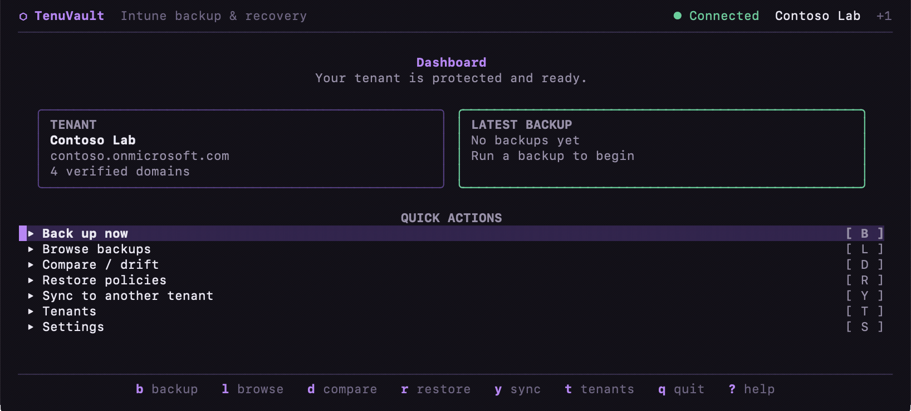
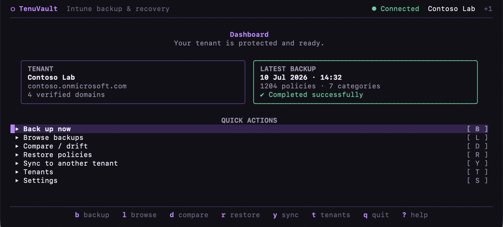
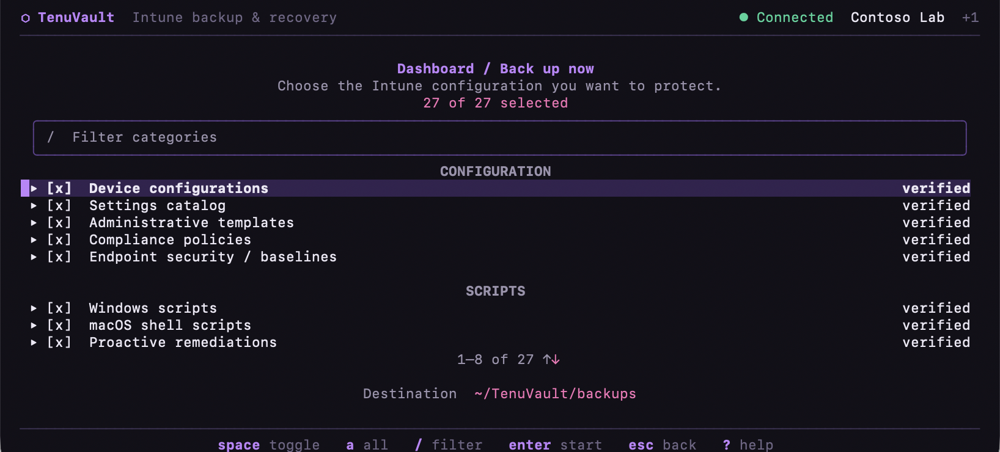
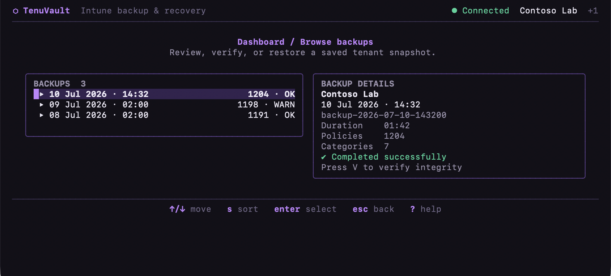
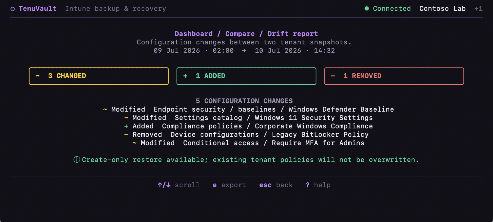
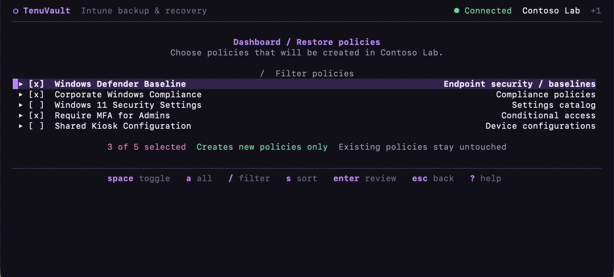
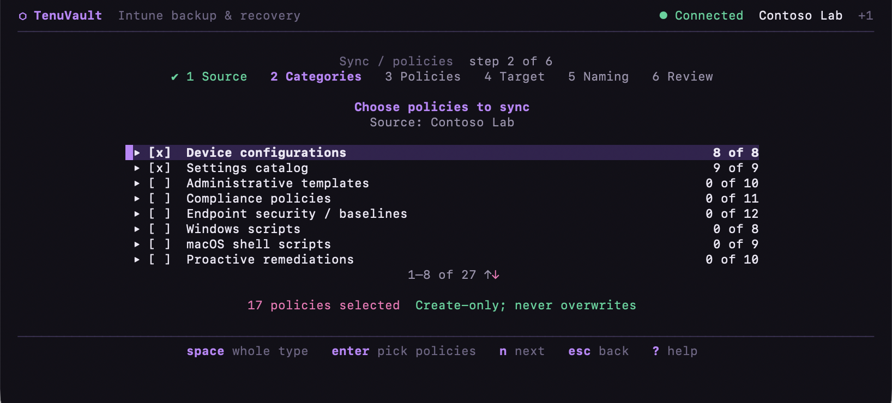
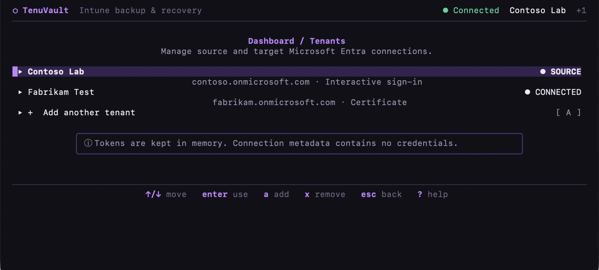
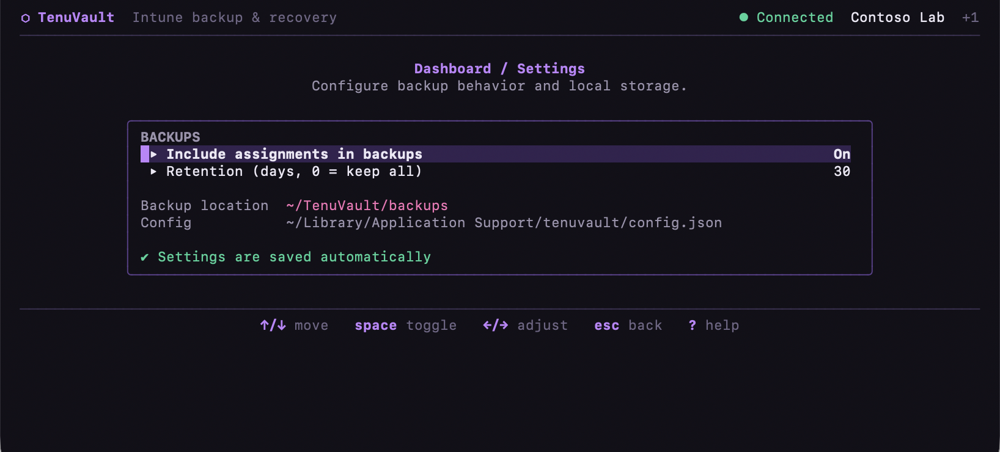

<h1 align="center">TenuVault TUI</h1>

<p align="center">
  Back up, verify, compare, restore, and sync Microsoft Intune configuration<br>
  from one terminal application.
</p>

<p align="center">
  <a href="https://github.com/ugurkocde/TenuVault-TUI/releases/latest"></a>
  <a href="https://www.powershellgallery.com/packages/TenuVault-TUI"></a>
  <a href="https://github.com/ugurkocde/TenuVault-TUI/actions/workflows/ci.yml"></a>
  <a href="go.mod"></a>
  
  <a href="LICENSE"></a>
</p>

<p align="center">
  
</p>

TenuVault stores portable, per-policy JSON backups locally. It supports 27
Intune policy types, interactive or app-registration authentication, offline
integrity/drift checks, create-only restore, and live or backup-based tenant
sync. It is a single Go binary with no database or service to deploy.

## Interface tour

These are captures of the real terminal renderer at 114 × 26 cells. The tenant
names and policy data are fictional; the layouts, controls, responsive behavior,
and progress states are the ones in the shipped application.

<table>
  <tr>
    <td width="50%"><br><strong>Dashboard</strong></td>
    <td width="50%"><br><strong>Back up now</strong></td>
  </tr>
  <tr>
    <td width="50%"><br><strong>Browse backups</strong></td>
    <td width="50%"><br><strong>Compare and drift</strong></td>
  </tr>
  <tr>
    <td width="50%"><br><strong>Restore policies</strong></td>
    <td width="50%"><br><strong>Sync tenants</strong></td>
  </tr>
  <tr>
    <td width="50%"><br><strong>Tenants</strong></td>
    <td width="50%"><br><strong>Settings</strong></td>
  </tr>
</table>

## What it does

- Captures full policy content, including scripts, Settings Catalog settings,
  Administrative Template definition/presentation values, security-baseline
  intent settings, and optional assignments.
- Records `metadata.json`, a human-readable log, and SHA-256 checksums; detects
  modified, missing, and untracked files with `tenuvault verify`.
- Compares two backups with stable, severity-ranked drift output.
- Restores and syncs by creating new objects only; existing tenant objects are
  not overwritten.
- Copies policies from a saved backup or a connected source tenant to a target
  tenant, with whole-type and individual-policy selection.
- Reports partial content, missing permissions, Graph errors, and filesystem
  failures instead of silently dropping data.
- Runs interactively with keyboard/mouse support or headlessly for automation.

## Install and update

### Windows

#### PowerShell Gallery (recommended)

```powershell
Install-Module TenuVault-TUI -Scope CurrentUser
tenuvault

# Later, update an Install-Module installation:
Update-Module TenuVault-TUI
```

Open a new PowerShell session after updating, then confirm the bundled binary:

```powershell
Get-InstalledModule TenuVault-TUI       # PowerShellGet
# Get-InstalledPSResource TenuVault-TUI # PSResourceGet
tenuvault --version
```

If you installed with PSResourceGet instead, use
`Update-PSResource TenuVault-TUI`. Package-manager updates do not apply to a
manually downloaded ZIP. The module requires 64-bit Windows, works in Windows
PowerShell 5.1 and PowerShell 7+, and runs on Windows ARM64 through x64
emulation. Use Windows Terminal, `pwsh`, or a console window for the TUI; the
PowerShell ISE supports headless commands only.

#### WinGet

TenuVault is also available from the
[Windows Package Manager catalog](https://github.com/microsoft/winget-pkgs/tree/master/manifests/u/UgurLabs/TenuVault)
for x64 and ARM64 devices:

```powershell
winget install TenuVault
tenuvault

# Later, update a WinGet installation:
winget upgrade --id UgurLabs.TenuVault --exact
```

#### Terminal requirements

For the full two-column dashboard, use a terminal of at least 88 columns and
24 rows. TenuVault also provides a compact layout down to 46 columns by 20
rows; below that it displays a resize prompt instead of allowing the interface
to wrap or clip.

### macOS

```sh
brew install ugurkocde/UgurLabs/tenuvault
brew upgrade tenuvault
```

Signed and notarized Apple Silicon `.pkg` and `.dmg` installers are also
available from the [latest release](https://github.com/ugurkocde/TenuVault-TUI/releases/latest).

### Linux

Download the package for your architecture from the
[latest release](https://github.com/ugurkocde/TenuVault-TUI/releases/latest):

```sh
sudo dpkg -i tenuvault_*_linux_amd64.deb
# or
sudo rpm -i tenuvault_*_linux_amd64.rpm
```

ARM64 DEB/RPM packages and raw tarballs are also published.

### Other options

- Windows ZIPs: `tenuvault_*_windows_amd64.zip` and
  `tenuvault_*_windows_arm64.zip` (unsigned; SmartScreen may prompt).
- Go: `go install github.com/ugurkocde/TenuVault-TUI@latest`
- Source: clone the repository and run `go build -o tenuvault .`

## Quick start

```sh
tenuvault
```

Choose interactive browser sign-in, client secret, or certificate. Interactive
sign-in needs no custom app registration. Device-code flow is intentionally not
supported because of its phishing risk.

Interactive-launch flags:

| Flag | Purpose |
| --- | --- |
| `-tenant <id-or-domain>` | Override the configured tenant |
| `-backup-root <path>` | Override the backup directory |
| `-version` | Print the binary version |

Main keys: `b` backup, `l` browse, `d` compare, `r` restore, `y` sync, `t`
tenants, and `s` settings from the dashboard. Arrows or `j`/`k` move,
`space` toggles, `/` filters, `s` sorts a list, `enter` selects, `esc` goes
back, and `?` opens contextual help. Use `v` to verify a selected backup, `e`
to export comparison/restore/sync results as JSON, and `x` to cancel an active
operation. `q` quits from the dashboard or initial sign-in screen; `Ctrl+C`
always exits.

The interface is fully usable with either keyboard or mouse. Click rows and
footer actions, use the wheel to move through lists, and click form fields to
focus them. When mouse support is active, hold `Shift` while dragging if you
want to select terminal text.

## Policy coverage

All 27 registered types are backed up and restorable. Values below are the keys
accepted by `--categories`.

| Area | Policy type keys |
| --- | --- |
| Configuration | `deviceConfigurations`, `configurationPolicies`, `groupPolicyConfigurations`, `compliancePolicies`, `intents` |
| Scripts | `deviceManagementScripts`, `deviceShellScripts`, `deviceHealthScripts`, `customAttributeScripts` |
| Enrollment and updates | `autopilotProfiles`, `enrollmentConfigurations`, `featureUpdateProfiles`, `qualityUpdateProfiles`, `driverUpdateProfiles` |
| Tenant administration | `roleScopeTags`, `deviceCategories`, `termsAndConditions`, `notificationTemplates`, `assignmentFilters` |
| Apps | `appConfigDevice`, `appConfigManaged`, `iosAppProtection`, `androidAppProtection`, `windowsAppProtection`, `windowsInformationProtection`, `appCategories` |
| Identity | `conditionalAccess` |

Enrollment configurations restore best-effort because default/singleton
configurations cannot be recreated. Administrative Templates and endpoint
security baselines use their required multi-step Graph create actions.

## Headless automation

Tenant-connected commands use app-registration credentials. Client-secret
example:

```sh
export AZURE_TENANT_ID=... AZURE_CLIENT_ID=... AZURE_CLIENT_SECRET=...

tenuvault backup --out ./backups --assignments
tenuvault backup --categories deviceConfigurations,compliancePolicies
tenuvault restore --backup ./backups/backup-... --prefix "[Restored] "
tenuvault compare ./backups/backup-old ./backups/backup-new
tenuvault verify ./backups/backup-...
```

`compare` and `verify` are fully offline. Exit codes:

| Command | Exit codes |
| --- | --- |
| `backup` | `0` completed, `1` failed, `2` invalid flags, `130` cancelled |
| `restore`, `sync` | `0` all created, `1` operation/auth failure, `2` usage or invalid input |
| `compare` | `0` no drift, `1` drift found, `2` usage/read error |
| `verify` | `0` intact, `1` mismatch/missing/extra file, `2` usage/read/no-checksum error |

### Headless tenant sync

The target uses `AZURE_*`. Supply exactly one source: a backup or a second live
tenant.

```sh
# Saved backup source
tenuvault sync --from-backup ./backups/backup-... --prefix "[Synced] "

# Live source tenant
export TENUVAULT_SOURCE_TENANT_ID=...
export TENUVAULT_SOURCE_CLIENT_ID=...
export TENUVAULT_SOURCE_CLIENT_SECRET=...
tenuvault sync --categories deviceConfigurations \
  --names "Baseline BitLocker" --dry-run
tenuvault sync --categories deviceConfigurations \
  --names "Baseline BitLocker"
```

For source-certificate auth use `TENUVAULT_SOURCE_CERT_PATH` and
`TENUVAULT_SOURCE_CERT_PASSWORD`. `--names` is an exact-name filter;
`--dry-run` lists planned creates without writing. A prefix-free sync is refused
when source and target are the same tenant or the backup does not identify its
source tenant.

## Restore and sync safety

- Restore/sync creates new policies and does not patch or delete existing tenant
  objects. The only delete is a compensating rollback of an incomplete
  Administrative Template created by that same operation.
- Restore defaults to `[Restored] `; sync defaults to `[Synced] `.
- Conditional Access policies are created disabled.
- Assignments are not copied because group IDs are tenant-specific. Backups made
  with `--assignments` retain them read-only and add `groups.json` for auditing.
- Failed enrichment is marked as partial content in results and exports.

## Microsoft Graph permissions

Interactive sign-in requests these delegated scopes. App-only authentication
uses `.default`, so grant and admin-consent the corresponding application
permissions on the app registration:

- `DeviceManagementConfiguration.ReadWrite.All`
- `DeviceManagementApps.ReadWrite.All`
- `DeviceManagementServiceConfig.ReadWrite.All`
- `DeviceManagementScripts.ReadWrite.All`
- `DeviceManagementRBAC.ReadWrite.All`
- `Policy.ReadWrite.ConditionalAccess`
- `Organization.Read.All`
- `Group.Read.All` — optional for resolving assignment group names; raw IDs are
  retained without it

Missing access is reported against the affected category.

## Configuration, storage, and security

Non-secret settings and remembered tenant metadata are stored in the OS config
directory under `tenuvault/config.json` (for example,
`~/Library/Application Support/tenuvault/config.json` on macOS). Client secrets,
certificate passwords, tokens, and browser credentials are not persisted.

Target environment variables: `AZURE_TENANT_ID`, `AZURE_CLIENT_ID`,
`AZURE_CLIENT_SECRET`, and `AZURE_CLIENT_CERTIFICATE_PASSWORD`. A target
certificate path is selected in the authentication form and can be reused by
headless commands through saved non-secret configuration.

Backups are written atomically under the configured root:

```text
backup-YYYY-MM-DD-HHMMSS.NNNNNNNNN[-N]/
  metadata.json        # written last; marks a complete backup
  checksums.json       # SHA-256 per policy file
  backup.log
  groups.json          # only when assignment names were resolved
  DeviceConfigurations/<policy>.json
  CompliancePolicies/<policy>.json
  ...
```

Policy JSON keeps the Graph content needed for restore while removing API
noise. Older second-precision backup-folder names remain supported. Incomplete
folders without `metadata.json` are hidden from browsing and later removed by
retention cleanup.

## Development and releases

```sh
test -z "$(gofmt -l .)"
go vet ./...
go test -race ./...
go build ./...
```

CI also lints and cross-builds Linux, macOS, and Windows targets. Pushing a
`v*` tag runs GoReleaser, macOS signing/notarization, package publishing, and
PowerShell Gallery validation/publication. See [SECRETS.md](SECRETS.md).

## License

MIT — see [LICENSE](LICENSE).
